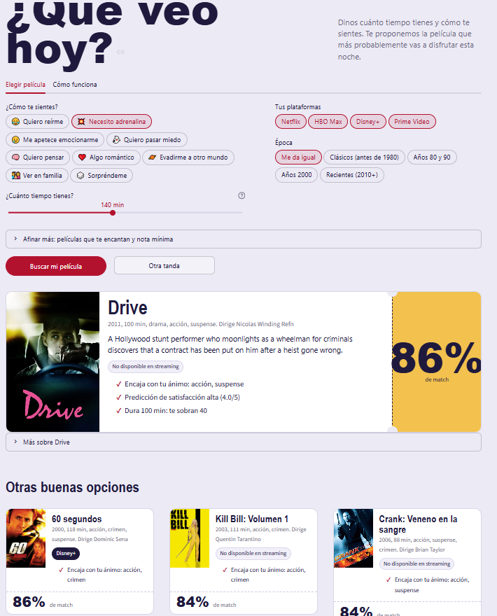
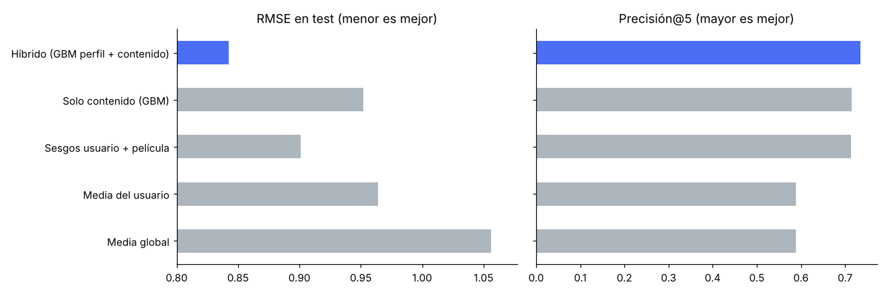

# ¿Qué Veo Hoy? — Buscador Predictivo de Entretenimiento

[](https://github.com/JMunoz2004/Buscador-Predictivo-de-Entretenimiento-Cine-TV-/actions/workflows/tests.yml)

**Demo:** _pendiente de despliegue en Streamlit Community Cloud_



## Descripción
"¿Qué Veo Hoy?" es una aplicación web interactiva diseñada para eliminar la parálisis por análisis y la fatiga de elección al buscar contenido en plataformas de streaming (Netflix, HBO Max, Disney+, Prime Video). A partir del tiempo disponible del usuario, su estado de ánimo, época preferida y suscripciones activas, la aplicación predice y recomienda mediante aprendizaje automático la película o serie con mayor porcentaje de afinidad (*match score*) para ese momento concreto.

## Objetivos
1. Consolidar y procesar un dataset unificado de metadatos cinematográficos y disponibilidad en plataformas de streaming.
2. Entrenar y evaluar un modelo de recomendación híbrido (filtrado basado en contenido y regresión) que prediga la satisfacción del usuario.
3. Desplegar una interfaz web pública, intuitiva y accesible desde cualquier dispositivo.
4. Implementar un flujo de desarrollo continuo mediante actualizaciones periódicas en el repositorio a lo largo del semestre.

## Cómo funciona

```
TMDb 5000 (metadatos) ─┐                         ┌─> Perfiles de usuario (afinidad por género, época)
                       ├─> limpieza + unión ─────┤
MovieLens (66.709      ┘   catalog.parquet       └─> Gradient Boosting: predice la nota (0,5–5)
valoraciones)              ratings.parquet                    │
                                                              ▼
Usuario de la app: ánimo + época + favoritas ─> perfil sintético ─> nota prevista por película
                   tiempo + plataformas ────────> filtros            │
                                                                     ▼
            match = 0,45·satisfacción + 0,25·ánimo + 0,20·contenido (TF-IDF) + 0,10·tiempo
```

1. **Datos** (`src/queveo/data.py`). Se unen las 4.137 películas válidas de TMDb 5000 con las valoraciones de MovieLens a través de `links.csv`. Se parsean las columnas JSON, se filtran títulos con menos de 20 votos, se imputa la duración que falta con la mediana del género y se construye un texto por película (sinopsis + eslogan + palabras clave + géneros).
2. **Perfil del usuario** (`features.py`). Cada usuario se describe con su nota media, su afinidad regularizada por cada uno de los 18 géneros y la época de las películas que más le gustan.
3. **Modelo** (`model.py`). Un `HistGradientBoostingRegressor` aprende la nota a partir del perfil del usuario, las variables de la película y sus interacciones. Los perfiles de entrenamiento se calculan *out-of-fold* para no filtrar la propia valoración.
4. **Recomendación** (`recommender.py`). El ánimo, la época y las películas favoritas se convierten en un usuario sintético con la misma forma que los perfiles de entrenamiento. El modelo puntúa todo el catálogo filtrado y la nota se combina con el encaje con el ánimo, la similitud TF-IDF y el aprovechamiento del tiempo.

### Resultados (20 % de las valoraciones de cada usuario reservadas para test)

| Modelo | RMSE | MAE | Precisión@5 |
| :--- | ---: | ---: | ---: |
| Media global | 1,056 | 0,845 | 0,588 |
| Media del usuario | 0,964 | 0,749 | 0,588 |
| Sesgos usuario + película | 0,901 | 0,689 | 0,713 |
| Solo contenido (GBM) | 0,952 | 0,744 | 0,716 |
| **Híbrido (GBM perfil + contenido)** | **0,842** | **0,644** | **0,735** |

Precisión@5: proporción de las 5 películas mejor puntuadas por el modelo que el usuario valoró con 4 o más. Las métricas completas están en `models/metrics.json`.



## Estructura del repositorio

```
app.py                      Interfaz Streamlit
src/queveo/
  config.py                 Rutas, géneros, estados de ánimo, pesos del match
  data.py                   Descarga, limpieza, imputación y unión de datos
  features.py               Perfiles de usuario y variables del modelo
  model.py                  Entrenamiento, validación y baselines
  recommender.py            Motor de recomendación y explicaciones
  tmdb_api.py               Pósters y disponibilidad real (opcional)
scripts/
  build_dataset.py          Genera data/processed/*.parquet
  train_model.py            Entrena el modelo y genera figuras
  make_eda_notebook.py      Genera y ejecuta notebooks/01_eda.ipynb
notebooks/01_eda.ipynb      Análisis exploratorio
data/processed/             Catálogo y valoraciones procesados (los originales no se suben)
models/                     Modelo entrenado y métricas
tests/                      Tests con pytest
```

## Ejecutar en local

```bash
python -m venv .venv && source .venv/bin/activate
pip install -r requirements-dev.txt
python scripts/build_dataset.py   # opcional: los datos procesados ya están en el repo
python scripts/train_model.py     # opcional: el modelo ya está en el repo
pytest -q
streamlit run app.py
```

## Despliegue (Streamlit Community Cloud)

1. Entrar en [share.streamlit.io](https://share.streamlit.io) con la cuenta de GitHub.
2. *Create app* → repositorio `JMunoz2004/Buscador-Predictivo-de-Entretenimiento-Cine-TV-`, rama `main`, archivo `app.py`. En *Advanced settings*, Python 3.12.
3. Opcional: en *Secrets*, añadir `TMDB_API_KEY = "..."` (clave gratuita de [themoviedb.org](https://www.themoviedb.org/settings/api)) para mostrar pósters, títulos en castellano y la disponibilidad real en España.

## Fuentes de datos
- [TMDb 5000 Movie Dataset](https://www.kaggle.com/datasets/tmdb/tmdb-movie-metadata) (Kaggle / The Movie Database).
- [MovieLens ml-latest-small](https://grouplens.org/datasets/movielens/latest/) (GroupLens Research, Universidad de Minnesota).

Se descargan desde copias públicas en GitHub indicadas en `src/queveo/config.py`.

## Limitaciones
- TMDb 5000 contiene películas hasta 2016; todavía no hay series.
- Sin clave de TMDb, la disponibilidad por plataforma es una **aproximación**: se deduce de la productora (Disney y Pixar en Disney+, Warner en HBO Max, MGM en Prime Video…) más una asignación estable que imita las licencias.
- MovieLens small tiene 671 usuarios; el modelo aprende patrones generales, no gustos individuales de quien usa la app.

## Plan de trabajo

| Fase | Tareas principales | Estado |
| :--- | :--- | :--- |
| **Fase 1: Datos y EDA** | Extracción de TMDb y MovieLens, limpieza, imputación de nulos y análisis exploratorio. | ✅ |
| **Fase 2: Feature engineering y modelo** | Perfiles de usuario, modelo híbrido, validación frente a baselines. | ✅ |
| **Fase 3: Motor de recomendación** | Usuario sintético, match score explicable, películas similares. | ✅ |
| **Fase 4: Frontend y despliegue** | Interfaz Streamlit adaptable a móvil y despliegue público. | 🔄 |

### Próximas mejoras
- [ ] Incorporar series de TV con un dataset de TMDb TV.
- [ ] Ampliar el catálogo más allá de 2016 con la API de TMDb.
- [ ] Sustituir la disponibilidad aproximada por la real (TMDb *watch/providers*) en todo el catálogo.
- [ ] Botones de "me gusta / no me gusta" para que el perfil aprenda durante la sesión.
- [ ] Probar MovieLens 25M y factorización de matrices como componente colaborativo adicional.
